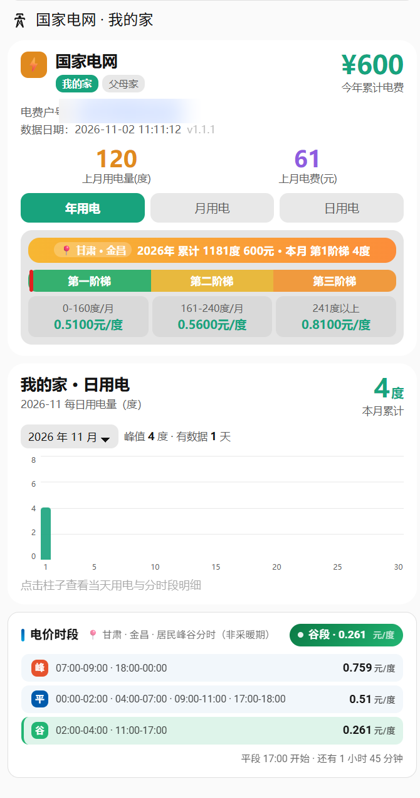

# 国家电网电费卡组（概览 + 用电趋势 + 电价时段）



一套 Home Assistant 前端自定义卡片，展示**国家电网（网上国网）的电费与用电数据**。**单文件包含三张卡**，放在同一仪表盘即可联动：

| 卡片类型 | 功能 |
| --- | --- |
| `custom:elec-summary-card` | **电费概览**：户号、数据更新时间 + 刷新按钮、今年累计电费、上月用电量 / 电费，年 · 月 · 日三页签；内嵌阶梯电价面板（三档进度条 + 当前档位气泡 + 各档电量与单价）；多户号胶囊切换 |
| `custom:elec-chart-card` | **用电趋势**：日用电 / 月用电柱状图，点击柱子查看电费（结算值或按阶梯估算）与尖 / 峰 / 平 / 谷分时段占比 |
| `custom:elec-price-card` | **电价时段**：峰 / 平 / 谷三行时段与单价，当前时段实时高亮，顶部胶囊显示当前时段，底部倒计时提示距下一时段还有多久 |

概览卡与趋势卡通过 localStorage 共享选中的户号：点账号胶囊，两张卡一起切换。

## 数据更新时间与刷新按钮

概览卡「数据更新」显示的是**集成上次抓数的时间**：优先读取 state_grid 提供的 `refresh_time` 传感器（由 `current_year_charge` 的实体名推导，即 `..._year_ele_cost` → `..._refresh_time`，可用 `accounts[].entities.refresh_time` 覆盖），取不到时退回该实体的 `last_updated`。鼠标悬停可看到集成抓数的原始时间。

旁边的「刷新」按钮只做一件事：**忽略卡片内的签名缓存，按 HA 当前状态重绘一次，并把显示时间推进到本次同步时刻**（先显示「同步中」，完成后显示「已同步」，3 秒后提示自动消失）。

- 它**不会**向网上国网发起任何请求，真正的抓数仍由 state_grid 集成按自己的周期（默认 12 小时）执行；
- 一旦集成真的抓到新数据（`refresh_time` 变了），显示的时间会自动换回新的抓数时间，不需要手动再点；
- 切换户号会清空本次同步记录，避免显示别的户号的时间。

## 电价口径（默认甘肃，均可配置）

- **阶梯电价**按月执行（甘发改商价〔2012〕881号）：第一档 0-160 度/月 0.51 元、第二档 161-240 度/月 0.56 元、第三档 241 度以上 0.81 元；档位判定用「本月累计用电」。
- **峰谷分时**（甘发改价格〔2021〕721号，非采暖期）：峰 07:00-09:00、18:00-24:00 → 0.759 元；平 00:00-02:00、04:00-07:00、09:00-11:00、17:00-18:00 → 0.510 元；谷 02:00-04:00、11:00-17:00 → 0.261 元。
- 其他省份请修改脚本内的 `ladderOf` / `markerPos` / `tierCost`（阶梯）与 `peak_ranges` / `flat_ranges` / `valley_ranges`、`*_price`（峰谷）；甘肃电采暖用户采暖期谷段为 07:00-12:00、19:00-24:00。

## 依赖

- Home Assistant ≥ 2024.1
- 电费概览 / 用电趋势的数据来自 **[state_grid](https://github.com/tiejiang29/state_grid) 集成**（国家电网，HACS 自定义集成）；实体名与默认规则不一致时可在 `accounts[].entities` 逐项映射。电价时段卡不依赖任何集成。

## 安装

### 方式一：HACS 自定义仓库（推荐）

1. HACS → 前端 → 右上角 ⋮ → 自定义存储库
2. 填入本仓库地址，类别选「Dashboard」
3. 搜索安装，刷新页面

### 方式二：手动安装

1. 把 `elec-dashboard-card.js` 复制到 `/config/www/community/elec-dashboard-card/`
2. 设置 → 仪表盘 → 右上角 ⋮ → 资源 → 添加资源
   - URL：`/local/community/elec-dashboard-card/elec-dashboard-card.js`
   - 类型：JavaScript 模块
3. 强制刷新浏览器（Ctrl / Cmd + Shift + R）

## 配置示例

```yaml
- type: custom:elec-summary-card
  accounts:
    - key: wo_jia            # 本地唯一标识，默认实体前缀 sensor.<key>_<后缀>
      name: 我的家           # 账号胶囊显示名
      number: "6267000584462"   # 户号（可选，直接显示）
      entities:              # 实体名与默认规则不一致时逐项映射（可选）
        current_year_charge: sensor.state_grid_6267000584462_year_ele_cost
        current_year_usage: sensor.state_grid_6267000584462_year_ele_num
        current_month_usage: sensor.state_grid_6267000584462_month_ele_num
        previous_settled_month_usage: sensor.state_grid_6267000584462_last_month_ele_num
        previous_settled_month_charge: sensor.state_grid_6267000584462_last_month_ele_cost
    - key: fu_mu_jia
      name: 父母家
      number: "6261200470785"
  region: 甘肃 · 金昌         # 阶梯气泡旁的位置标注，填 "" 隐藏

- type: custom:elec-chart-card
  accounts:                  # 与概览卡相同的 accounts 配置
    - key: wo_jia
      name: 我的家
      entities: {}

- type: custom:elec-price-card
  title: 电价时段
  subtitle: 甘肃 · 金昌 · 居民峰谷分时（非采暖期）   # 填 "" 隐藏
  peak_ranges: [[7, 9], [18, 24]]
  flat_ranges: [[0, 2], [4, 7], [9, 11], [17, 18]]
  valley_ranges: [[2, 4], [11, 17]]
  peak_price: 0.759
  flat_price: 0.51
  valley_price: 0.261
  unit: 元/度
  show_next: true
```

## 配置字段

### 概览卡 / 趋势卡（accounts）

| 字段 | 说明 |
| --- | --- |
| `accounts` | 必填，户号列表；每项 `key`（必填）、`name`、`number`、`entities`（可选映射） |
| `region` | 概览卡阶梯气泡旁的位置标注，默认「甘肃 · 金昌」，`""` 隐藏 |
| `estimateCharge` | 趋势卡：无结算值时是否按阶梯估算电费，默认开启，`false` 关闭 |
| `debug` | 概览卡：显示原始 accounts JSON，排查实体映射用 |

实体后缀（默认拼 `sensor.<key>_<后缀>`）：`current_year_charge`（今年累计电费）、`current_year_usage`（今年累计用电）、`current_month_usage`（本月累计用电，用于阶梯档位）、`previous_daily_usage`（近日用电）、`previous_settled_month_usage`（上月用电量）、`previous_settled_month_charge`（上月电费）。`refresh_time`（集成抓数时间）默认由 `current_year_charge` 推导，一般无需配置。

### 电价时段卡

| 字段 | 默认 | 说明 |
| --- | --- | --- |
| `title` | 电价时段 | 卡片标题 |
| `subtitle` | 甘肃 · 金昌 · 居民峰谷分时（非采暖期） | 标题旁位置 / 规则标注，`""` 隐藏 |
| `peak_ranges` / `flat_ranges` / `valley_ranges` | 见示例 | 各时段起止小时（24 小时制，左闭右开） |
| `peak_price` / `flat_price` / `valley_price` | 0.759 / 0.51 / 0.261 | 各时段单价 |
| `unit` | 元/度 | 单价单位 |
| `show_next` | true | 是否显示下一时段倒计时 |

## 常见问题

- **阶梯档位不对**：默认按甘肃「按月执行」预置；按年分档的省份改脚本里 `ladderOf` / `markerPos` / `tierCost`
- **峰谷时段不对**：改电价时段卡的 `*_ranges` 与 `*_price`；采暖期电采暖口径见上文
- **数字显示 --**：对应实体不存在或被隐藏，概览卡加 `debug: true` 查看，并在 `entities` 里补映射
- **更新后样式没变**：给资源 URL 加 `?v=3` 之类后缀破缓存，或清浏览器缓存

## 更新记录

- **v1.2.5**：概览卡「数据日期」改为「数据更新」，显示集成抓数时间（`refresh_time`），并在其后加「刷新」按钮（只重绘卡片、把时间推进到本次同步时刻，不触发向国网的抓数）；按钮样式改为与文字协调的浅色胶囊 + 环形箭头，同步中图标旋转、完成提示「已同步」
- **v1.2.0**：合并电价时段卡为单文件三卡；阶梯改为甘肃「按月执行」口径；阶梯气泡加位置标注
- **v1.1.1**：新增电量趋势卡与尖 / 峰 / 平 / 谷分时占比

## 许可

MIT
